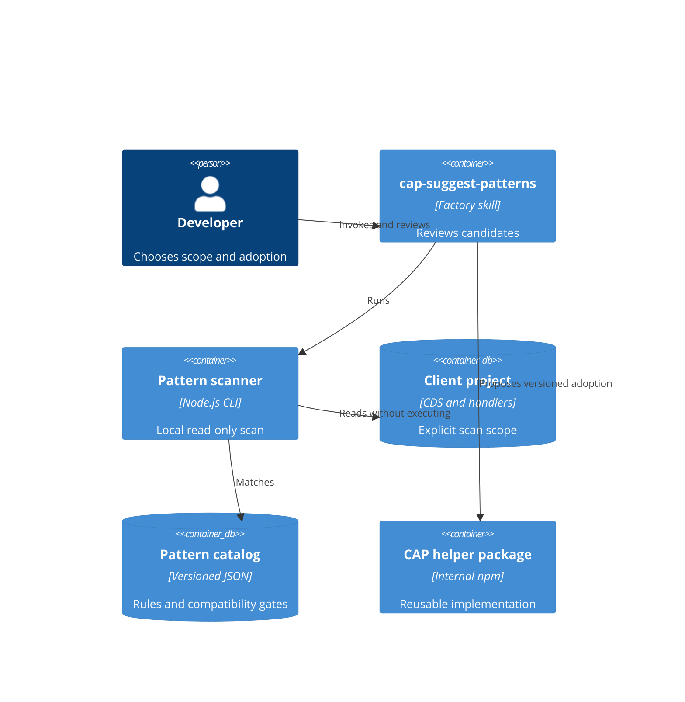

# CAP-AI-11: CAP Pattern Suggestions

Status: Proposed; tested offline pilot candidate, production admission pending.
Release baseline: 0.1.0, first EPAM source contribution; not committed or tagged yet.
Scope: Greenfield, Brownfield, Bluefield, Product Development; Realize.
Decision owner: Vera Lazouskaya. Library reviewer and reuse-rights approver are
separate responsibilities, even when one person holds both.

## Decision

Keep reusable implementation in a versioned npm package, not Markdown snippets.
Keep discovery metadata in a JSON catalog next to the scanner. Use an explicitly
invoked factory skill to interpret deterministic evidence and propose changes.
Prefer CAP-native APIs over adding dependencies. Do not build a vector database,
hosted service, universal code rewriter, or automatic background agent for this MVP.



## Contracts

- Scanner: Node.js 22+, explicit CAP Node.js project root and optional file/folder
  scopes; no network, project imports, lifecycle scripts, installation, or writes.
- Inventory: sorted scanned paths, excluded paths/reasons, unreadable/oversize
  paths, CDS version declaration, candidate evidence with file and line. Empty
  results mean only no heuristic matches within the recorded scope.
- Catalog: stable pattern ID, kind (native/helper), maturity, source documentation,
  positive signals, compatibility checks, contraindications, adoption example.
- Report: versioned JSON with deterministic finding IDs. Candidates are not
  semantic proofs. The skill must inspect surrounding handlers and the effective
  CDS model before recommending a replacement. No confidence percentages.
- Package: proposed internal name `@epam/cap-pattern-helpers`; currently private,
  unpublished, and tested locally. No claim of an existing vetted internal library.
  CAP integration/version certification is a release gate, not inferred from unit tests.

## Implemented Scope

Detect manual properties-file access, query-limit mutation, draft annotations,
and upstream error-message forwarding. Recommend native APIs for the first three;
offer an opt-in remote-error helper for the fourth only after checking the service
contract. Retain CAP's error sanitization. No universal upstream error parsing.
The 0.1.0 catalog also reviews remote-service consumption, declarative validation,
common CDS aspects, query parameterization, and transaction boundaries (nine entries).
The scanner uses bounded reads, worker deadlines, and evidence fingerprints. It
returns compact grouped review JSON by default; --full provides the inventory,
--report prepares saved reports, --context reads selected source excerpts, and
--decisions reconciles declared evidence and per-ID progress. Incomplete coverage
returns exit 2 with JSON; invalid input returns 1. Changed fingerprints reopen reviews.

All new governed components, catalog, policy, scanner, and helper package start at
0.1.0 for this first EPAM baseline. Earlier public GitHub pilot tags are retained as
historical experiments, not renamed or presented as factory releases. A release tag
should be created only after this baseline has been reviewed and committed.

The agent is a thin host-neutral entry point and the skill owns one procedure.
It loads guidance once and keeps results needs-review when evidence is unresolved.
Query gates cover input/null/type behavior, association semantics, backend functions,
authorization path, clean diffs, and fixture-based expectations. Decision validation
checks declarations and counts, not semantic truth, test execution, or acceptance.
Tests use synthetic entities only. Native adapters register this same workflow for
each supported host; model obedience still needs live-session acceptance evidence.
Read batches are limited to three IDs, 10 preceding/20 following lines, and 8,000
characters per excerpt, with selected source/manifest hashes checked before reading.
This bounds tool-supplied context, not total LLM tokens or provider billing.
Java is explicitly unsupported; TypeScript is inspected heuristically, not compiled.
No AST or CDS compilation occurs in the scanner; semantic verification belongs to
the skill using the target project's supported CAP tooling with user permission.

## Adoption And Contribution Boundaries

Default outcome is a local proposal with an example/diff and tests, never edits,
dependency installation, registry publishing, or client-code upload. Project rules
and established libraries can justify declining every suggestion.

CAP-AI-12 is a future intake workflow: rights clearance, anonymized isolated
submission, duplicate comparison by intent/API/semantics, maintainer review,
compatibility tests, versioned release, then catalog update. Anonymization is not
permission to reuse client code. No client extraction or publication is implemented.
CAP-AI-10 hybrid testing is a separate use case and is not implemented here.

## Validation And Release

Run Node unit/CLI tests, factory dependency/schema checks, adapter packaging tests,
and registry regeneration checks. Before production use, select supported CDS
majors and run real CAP HTTP/error/i18n tests for each; approve package name,
registry, ownership, license, and rights. Keep maturity `experimental` until then.
Reopen accepted recommendations as `reopened` with reason and prior decision
history if later evidence invalidates them; never silently overwrite approval.
The supplied 10% and 40% figures are planning assumptions, not measured savings.
Real helper OData HTTP tests passed for CAP 9.9.3 and 10.1.1 on Node 24.5.0/macOS,
with production sanitization and test-only dummy authentication. The CI matrix is
configured for Node 22/24; configured checks are not proof of a completed pipeline.
The helper remains experimental pending governance and customer acceptance.

The documented Assistant -> Agent -> Skill -> Tool route is incomplete: the owning
Developer Assistant and controlled role/use-case/operation IDs still need practice
approval. Preserve CAP-AI-11 as the pilot selector rather than inventing approval.
Nine baseline factory-validator errors remain a repository merge-admission blocker.

Sources: [CAP i18n](https://cap.cloud.sap/docs/node.js/cds-i18n),
[generic providers](https://cap.cloud.sap/docs/guides/services/served-ootb),
[request errors](https://cap.cloud.sap/docs/node.js/events#req-reject).
The supplied SAP skill references informed workflow boundaries; their content was
not copied and their incomplete reference trees are not runtime dependencies.

## Customer Environment Testing

For a short environment-by-environment guide, see
`docs/user-guide/cap-patterns-quickstart.md`.

Use the portable workflow in `tools/cap-pattern-scanner/README.md`. Export the live
working tree with the existing factory packager, transfer the ZIP through an approved
customer channel, and run the scanner from the extracted folder outside the client
checkout. No Git push, customer-to-EPAM access, npm install, or client mutation is
required. Source/reports remain inside the customer environment; AI review uses only an approved provider.

## Factory Installation (Optional)

For a new disposable workspace only, the factory adapter can install the use case.
Every adapter overwrites its generated entry files (`CLAUDE.md`,
`.cursor/rules/factory.mdc`, `.github/copilot-instructions.md`) and the Copilot adapter
updates VS Code settings; do not use any of them on an established customer workspace
(see Follow-Up: Installer Overwrite Behavior):

```sh
python3 scripts/github-copilot/adapter/install.py --project /path/to/cap-project --use-case CAP-AI-11
```

In that client workspace, explicitly ask the assistant to use `cap-suggest-patterns`
on the named handler/model folders, or run the deterministic evidence scan directly:

```sh
node tools/cap-pattern-scanner/scripts/scan.mjs /path/to/cap-project srv db
```

This does not install the helper as an application dependency. The factory adapter
copies its source alongside the scanner; adoption requires a separate reviewed
decision. Test the implementation in the factory with:

```sh
node --test tools/cap-pattern-scanner/scripts/scan.test.mjs tools/cap-pattern-scanner/helpers/index.test.js
```

## Portable Baseline

Keep the current factory component layout. It separates the responsibilities
needed by CAP-AI-11 without introducing a server, model vendor SDK, or orchestration
framework. A recommendation to use native CAP is valid; a custom helper is not
required for every pattern. The one bundled npm helper remains private/experimental.
Move it into an independently released library only when ownership, compatibility,
and real reusable APIs justify that release, not to increase the catalog count.

```text
agents/cap-pattern-advisor/       bounded entry point and output contract
skills/cap-suggest-patterns/     one shared review procedure
tools/cap-pattern-scanner/       catalog, deterministic CLI, policy, tests
  scripts/                      scan, match, prepare, context, reconcile
  helpers/                      private experimental npm helper
scripts/<host>/adapter/          native delivery, not separate domain logic
docs/adr/                       architecture and acceptance boundaries
```

Supported packaging adapters (same CLI/catalog/policy in every layout):

| Host | Agent | Skill | Entry |
|---|---|---|---|
| Claude Code | `.claude/agents/cap-pattern-advisor.md` | `.claude/skills/cap-suggest-patterns/` | `CLAUDE.md` |
| GitHub Copilot | `.github/agents/cap-pattern-advisor.md` | `.agents/skills/cap-suggest-patterns/` | `.github/copilot-instructions.md` |
| Cursor | `.cursor/agents/cap-pattern-advisor.md` | `.cursor/skills/cap-suggest-patterns/` | `.cursor/rules/factory.mdc` |

Adapter installation and identical shared scanner content are tested for all three.
Do not confuse packaging tests with live-host certification. Current VS Code docs
allow plain .md files under .github/agents even though .agent.md is the conventional
extension; do not change shared adapter APIs speculatively. Existing adapters can
overwrite their generated entry files, so run them into fresh staging/tooling folders,
not blindly over established customer configuration.

Other approved assistants can use the same CLI/JSON contracts if they can execute
local commands and read files. A browser-only assistant needs an approved external
local execution step. No automatic native registration is claimed for hosts without
an adapter. CAP Java remains unsupported; inspecting an application's Node version
does not execute it or change its runtime dependencies.

Cost policy: no AI-based JSON extraction, one skill/guidance load, small requested
samples, hash-checked --context batches, named dependency follow-ups only, and stop
at needs-review when evidence is unavailable. Do not launch a coordinator just to
run one skill or reread full files for repeated matches. Measure end-to-end token
usage on the next approved pilot; a tool excerpt budget is not a measured savings claim.

## Follow-Up: Installer Overwrite Behavior

Status: open, outside CAP-AI-11 scope; needs the Factory infrastructure owner.

Observed 2026-10-18 by installing `--use-case CAP-AI-11` with each adapter over a
workspace holding pre-existing files: `claude-code`, `cursor`, and `github-copilot`
silently replaced `CLAUDE.md`, `.cursor/rules/factory.mdc`,
`.github/copilot-instructions.md`, and the installed agent/skill files, with no prompt
or backup. This is by design for generated files (the generated header says it will
overwrite), and it affects every use case because the logic is shared
(`scripts/adapter_common.py` and each `install.py`). CAP-AI-11 therefore keeps the
documented rule of installing only into an empty staging folder; a delivery test pins
the exact file set each adapter writes. A possible fix, not approved or implemented,
is to refuse to replace files that are absent from `factory-lock.json` unless forced.
Changing it requires an owner decision and regression tests across all use cases.

## Commit Boundary

Recommend one cohesive feature baseline containing the three governed components,
this ADR, the generated registry outputs, and the narrowly related CI validation.
All source files under the new component directories are currently new to Git;
plain git diff --stat does not list their content until staged.

Review/stage explicitly (do not use git add .):

```sh
git add -- agents/cap-pattern-advisor skills/cap-suggest-patterns tools/cap-pattern-scanner docs/adr/cap-ai-11-pattern-suggestions.md docs/user-guide/cap-patterns-quickstart.md factory-data.json factory-data.js index.html .gitlab-ci.yml
git diff --cached --stat
git diff --cached --check
```

Suggested message: `feat: add CAP-AI-11 portable review baseline v0.1.0`.
Do not stage the user's reference copies under validators/, generated delivery ZIPs
outside this clone, customer source/reports, or unrelated files. Push this feature
branch to EPAM for review, not the full factory tree/history to the public ZIP host.
No commit/push is implied by this document. Production admission is still blocked
by the governance/runtime/customer-acceptance and baseline-validator gaps above.

Do not refactor all three existing installer implementations or invent new versioned
dependency syntax as part of this feature. Those platform changes need a separate,
tested proposal rather than being mixed into the CAP review baseline.